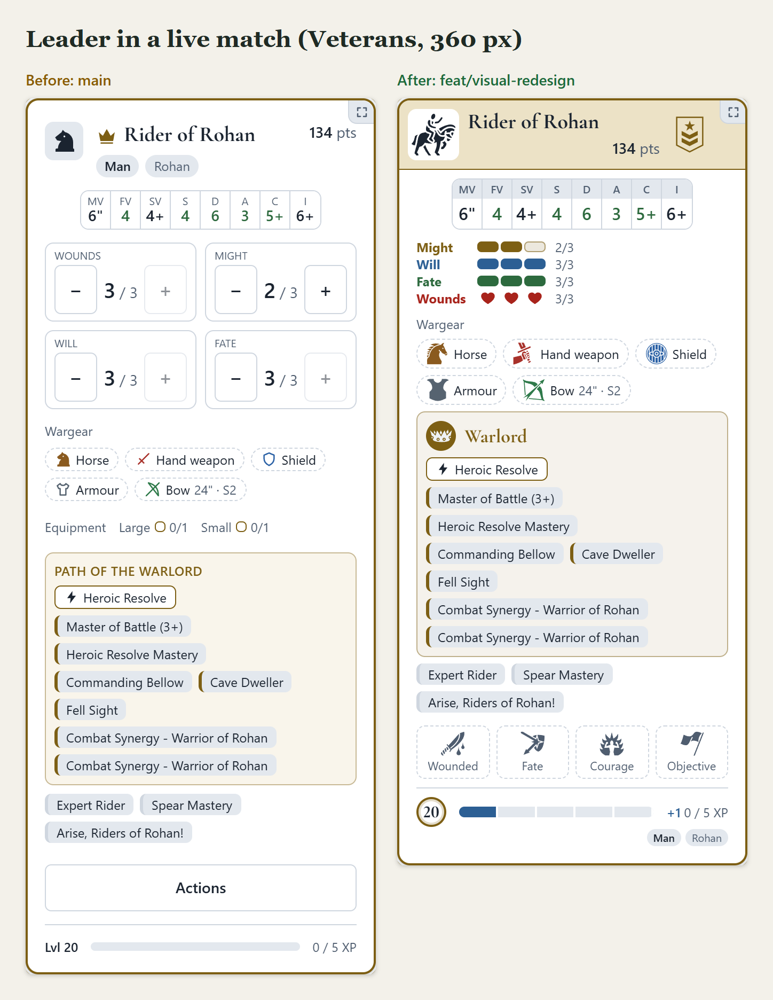
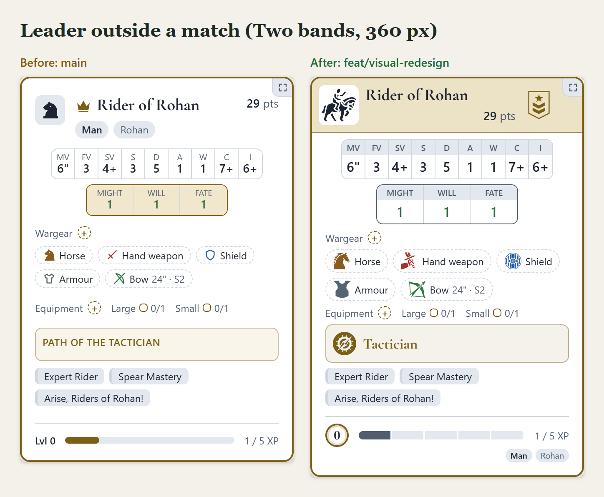

# Unit card redesign: before and after

What the `feat/visual-redesign` branch changes in the unit cards of My Company (outside a match and during a live match), shown
side by side with `main`. Unlike [match-redesign](../match-redesign/README.md), which compared proposals, these pictures are
**screenshots of the real app**: the left column is `main` (merge base `4ddca81`), the right one is the branch.

## What changed

**The card**

- **Title plate per rank.** The top of the card is a plate tinted by the unit's place: gold for the leader, green for a sergeant,
  blue for a hero, plain for a warrior, danger while injured. A rank insignia (chevrons) sits on the right of the plate and the frame
  takes the same colour; the crown and star before the name are gone.
- **Unit icon.** The square at the top left draws what the unit is (rider, foot soldier with shield, archer...) with
  [game-icons.net](https://game-icons.net) drawings, bigger than the old chess-piece glyph. A pencil on the plate renames the unit.
- **Profile as a datasheet.** The characteristic names sit on a strip above larger values; Might, Will and Fate use the same table
  instead of a gold box.
- **Race and faction move to the foot** of the card as keywords, freeing the header for the name and the points.
- **Gear icons.** Each item has its own coloured icon by class (mount, hand weapon, two-handed weapon, halberd drawn as spear plus
  axe, shield, armour, heavy armour, bow, throwing weapon...), and an **Elven weapon carries a small green leaf** on its corner.
  All the drawings come from one cached SVG sprite.
- **Hero path box.** The path shows its name with an icon and a colour of its own (Warlord, Tactician, Sharpshooter, Soldier...),
  instead of an upper-case "PATH OF THE ..." label.
- **Level medal and XP bar.** The level is a gold medal; the experience bar is cut into one segment per point, and during a match
  the experience earned in it (added in the aftermath) shows as "+1" on the bar and before the count.

**During a live match**

- **Trackers as segmented bars.** Might, Will and Fate are rows of coloured pips and Wounds are hearts, all tappable, in place of
  four boxes of - / + buttons. A warrior with one wound has a single heart row.
- **Simpler actions.** The "Actions" button gives way to a row of match milestones at the foot of the card (Wounded, Fate, Courage,
  Objective) that the owner presses; a lit Fate or Courage undoes its entry. Heroes get the Fate mark, warriors do not.
- Cards are shorter: on the Veterans company at 360 px the leader's card goes from 820 to 718 px, a sergeant from 722 to 614 px and
  a warrior from 448 to 366 px; the whole page from 16,038 to 14,778 px.

**Themes and settings**

- **Dark palettes** with clearly separated layers, and **game colours** (rank, Might/Will/Fate/Wounds, gear classes) shared by
  every palette.
- **High-contrast variant** of every palette (per browser), from the Appearance menu.
- **Gear style setting**: gear as chips with names (default) or as icon tiles, with a sample below the toggle.

**Around the cards** (not pictured): segmented limit bars that show the models the company's rules exempt; the campaign opens on
My Company; the Companies tab is gone and Rankings lists every company.

## The pictures

| Picture | What it shows |
|---|---|
| [1-leader-card-live.png](1-leader-card-live.png) | The leader (Path of the Warlord, level 20) in a live match: - / + boxes against pip and heart trackers, Actions against the milestone marks. |
| [2-leader-card.png](2-leader-card.png) | A level 0 leader outside a match: title plate, insignia, datasheet profile, gear icons, path box with icon, medal. |
| [3-sergeant-and-warrior-live.png](3-sergeant-and-warrior-live.png) | A sergeant (green plate) and a warrior (plain plate, one heart) in a live match. |
| [4-elven-company.png](4-elven-company.png) | An Elven company: unit icons, the Elven leaf on the weapons, steed and heavy armour icons. |
| [5-dark.png](5-dark.png) | Dark mode in a live match, leader and warrior. |
| [6-desktop-1280.png](6-desktop-1280.png) | My Company at 1280 px: the three-column grid of cards and the segmented limit bars. |
| [7-new-options.png](7-new-options.png) | Only on the branch: gear as chips or tiles, and the high-contrast variant in light and dark. |

## How the pictures were made

- Two servers on the same development database loaded with the demo world (see [demo-world.md](../../demo-world.md)): `main` at
  `4ddca81` and the branch. Signed in as `eowyn@example.com` (campaigns *Veterans: heroes with long trackers and full paths* and
  *Two bands: several companies per player*) and `galadriel@example.com` (*Settings: everything on, own paths level up*, her Lothlórien company).
- Headless Chrome through the repository's `puppeteer-core` (in `tests/e2e`): 360x800 at device scale 2 for the phone frames,
  1280x800 at scale 1 for the desktop one. The default palette (Forest & Gold) in light mode unless the picture says otherwise; Galadriel's
  account uses its own saved palette. Dark mode, high contrast and the gear style are switched by setting the `data-mode`,
  `data-contrast` and `data-gear` attributes of `<html>`, as the Appearance menu does.
- Each card is an element screenshot with the sticky header and the live-match bar unpinned, so they do not cover it.
- [`src/shot.mjs`](src/shot.mjs) takes the screenshots and [`src/compose.mjs`](src/compose.mjs) lays them out in sheets; copy them to
  `tests/e2e` to run them (they import `puppeteer-core` from there; `CHROME_PATH` points at Chrome).
