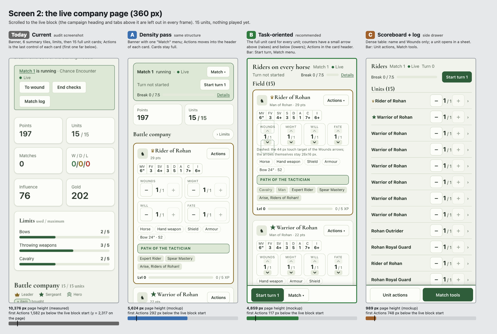

# Match and live-match redesign: pictures of the three designs

Companion to [issue #24](https://github.com/iuya/battle-company-manager-ce-v2/issues/24), which describes the problem (measured on the real
screens), the three designs and the recommendation. These pictures let contributors compare the alternatives at a glance before
voting. Nothing here is built in the app: it is a design discussion, not documentation of the current state.

- **A: density pass.** Same structure, smaller controls, Actions in the unit card header, merged names, sentences behind (i).
- **B: task-oriented (recommended, in two steps).** Sticky bottom action bar; on the live page the **full unit card for every unit**
  (the same card as the non-live company page), Wounds/Might/Will/Fate counters with a small up arrow above the number and a down
  arrow below it, and Actions as a compact pop-up opened from the card header (a small sheet at 360 px, a popover on desktop);
  an aftermath where only exceptions are opened. Step 1 is A's no-regret changes. (Revised after the owner's feedback on #24: the
  first version of B drew compact unit rows with -/+ buttons and a tile sheet.)
- **C: scoreboard + log.** A scoreboard and the match log on the page, every tool in a drawer (a bottom sheet at 360 px), units as a table.

In every 360 px sheet the columns are **Today | A | B | C**; each frame is the same 360x800 viewport. Under each frame is a bar for the page
height (the black tick marks one 800 px screen) and, for the live page, where the first "Actions" control is.

## The pictures

| Picture | What it shows |
|---|---|
| [1-match-page.png](1-match-page.png) | Screen 1, the match page, open, at 360 px: Today, A, B, C. |
| [2-live-company-page.png](2-live-company-page.png) | Screen 2, the live company page with 15 units, at 360 px. Today: 10,376 px and Actions far below; mockups: 5,624 (A), 4,859 (B), 989 px (C). |
| [3-live-actions.png](3-live-actions.png) | Screen 3a, the Actions menu of a unit: centered window (A), small sheet of 44 px tiles from the card header (B), quick-action field and flat list (C). |
| [4-live-end-checks.png](4-live-end-checks.png) | Screen 3b, End checks (objective and MVP): 27 rows today; two-column toggles (A), chips grouped by company (B), a table (C). |
| [5-aftermath.png](5-aftermath.png) | Screen 4, the aftermath Sheet step: today 10,973 px; mockups 4,592 (A), 1,313 (B), 1,663 px (C). |
| [6-b-in-two-steps.png](6-b-in-two-steps.png) | The recommendation: Today, then step 1 (A's no-regret changes), then step 2 (B: full cards, arrow counters, Actions pop-up), for the live page and the match page. |
| [7-b-desktop-1280.png](7-b-desktop-1280.png) | Design B at 1280 px: the match page (sticky right panel, no bottom bar) and the live company page (full unit cards in a three-column grid, Actions as a popover under the card header button). |
| [8-b-dark.png](8-b-dark.png) | Design B at 360 px in light and dark (match page and live page). |



## How the pictures were made, and how far to trust them

- **Static HTML mockups, not the real app.** They load the app's real compiled stylesheet (`internal/web/static/app.css` from `make css`) and
  fonts, so the colours, the Forest & Gold light and dark tokens and the Cormorant Garamond headings are the real ones, and only semantic tokens are used.
  The layout, sizes and spacing of the new parts are drawn by hand: **they are indicative, not measured from an implementation.**
- **Sample data** comes from the audited demo world: the 15-unit company "Riders on every horse" (Éowyn) against "Garrison of Helm's Deep" (Sauron),
  scenario Chance Encounter, 143 and 54 rating. Unit names, points and gear are plausible, not the exact demo values.
- **"Today" frames** are crops of the issue's audit screenshots (headless Chrome, scale 1, so slightly softer). Page heights shown for
  Today are the measured ones from the issue. Page heights shown for A, B and C are those of the mockups (the `body` height at 360 px) and are lower
  bounds: a mockup draws only the parts that matter for the comparison. They differ from the issue's estimates (A about 7,500, B about 2,000,
  C about 1,500 px for the live page) because the mockup of A leaves out the Limits and legend blocks and C uses rows of about 65 px.
  B now keeps full cards: **4,859 px is a lower bound for 15 units** (about 280 px per card, 15 cards, plus the header; the leader's card with
  the Path is about 650 px), against about 2,000 px for the earlier compact-row version. It leaves out the summary tiles, Limits and legend like the
  other mockups, so the real page is a few hundred px taller. At 1280 px the cards form a three-column grid and the same page is 1,785 px.
- Rendered with Chrome through the repo's `puppeteer-core`: 360x800 at device scale 2 (frames) and 1280x900 at scale 1 (desktop), light theme
  except picture 8.

### Where a mockup does not match its wireframe

- The live-page frames start at the live block: the app header, the campaign heading and the tab bar above it are left out in every column,
  so "first Actions" is measured from the start of the live block (Today: about 1,582 px; 2,317 px on the real page).
- Tooltips, accordions, the bottom sheet and the Alpine behaviour are static: an (i) is only an icon, collapsed cards show no content.
- B at 1280 px shows End checks, Result and Roles collapsed (as in the wireframe), so the match page looks sparse there.
- C is drawn at 360 px only. The match page shows the "Match tools" bar closed, and the aftermath ledger is shown as two lines per unit (the
  table with column headers is the 1280 px layout of the wireframe, not drawn). The unit table of the live page has only the Wounds
  stepper at 360 px, as in the wireframe.
- A and C have no 1280 px picture.
- **B's live cards differ from the earlier wireframe** (compact rows, -/+ steppers, tile sheet, collapsible cards): the card is now the full
  one for every unit, drawn with race, characteristics, counters, gear, keywords and rules (the keywords and rules of the rank and file units
  are invented but plausible, the Rider's Path is the one of the other frames). Collapsible cards are dropped on the live page, because
  the card is what a player reads; a "collapse all" control could be added later and is not drawn.
- **Counter arrows.** Each counter (Wounds, Might, Will, Fate) shows a small arrow above the number (raises) and below it (lowers),
  26x16 px on screen, so a card needs one row of four counters of about 80 px instead of two rows of -/+ steppers. The touch target of
  each arrow is a 44x44 px area (a pseudo-element that extends past the drawn arrow over the label above or the gear below, never over the
  other arrow); it is drawn dashed on the Wounds counter of the first card. On a mouse the arrows keep their small size. An arrow that
  cannot act (at the maximum) is dimmed, as the + button is today.
- **Actions pop-up.** The Actions button sits in the card header (36 px on mouse, 44 px on touch). On a phone it opens a small sheet of six
  44 px tiles (about 230 px high, the dimmed page and the unit's card behind it, picture 3); from 768 px it is a popover of six 34 px
  items anchored under that button (picture 7, open on the first card). Neither is a bar under each card. The sticky bottom bar (Start turn,
  Match menu) stays on a phone and becomes buttons in the header from 768 px.
- End checks show 12 of the 27 rows (marked in the frame), to keep the frame at one screen.
- The ring watermark of the real pages is not drawn.

## Sources

[`src/`](src/) holds what produced the images; the generated pages are not committed because they are plain output of `build.mjs`.

| File | Role |
|---|---|
| [`src/build.mjs`](src/build.mjs) | Writes the mockup pages (`pages/*.html`): all CSS, the sample data and one function per screen and design. Edit this to change a mockup. |
| [`src/render.mjs`](src/render.mjs) | Renders every page to PNG with Chrome and writes the page heights (`out/heights.json`). |
| [`src/sheets.mjs`](src/sheets.mjs) | Composes the comparison sheets (`sheets/*.png`) from the renders and the "Today" crops. |
| [`src/crop.mjs`](src/crop.mjs) | Crops the "Today" frames (`cur/*.png`) out of the issue's full-page audit screenshots. |

To rebuild, in a scratch directory (not in the repo, so the repo's `node_modules` stays untouched):

```sh
mkdir -p /tmp/mockups/static && cd /tmp/mockups
cp <repo>/docs/design/match-redesign/src/*.mjs .
make -C <repo> css && cp <repo>/internal/web/static/app.css static/
cp -r <repo>/internal/web/static/fonts static/fonts && sed -i 's#/static/fonts/#fonts/#g' static/app.css
ln -s <repo>/tests/e2e/node_modules node_modules          # puppeteer-core; set CHROME_PATH if Chrome is elsewhere
node build.mjs && node render.mjs
# the "Today" frames: crop the issue's audit screenshots into cur/ (m1, l1, a1, act, end) with crop.mjs, then
node sheets.mjs                                           # writes sheets/*.png
```

The "Today" crops (`cur/m1.png` y=60 of R-match-360-light, `l1.png` y=700 of R-live-360-light, `a1.png` y=60 of R-aftermath-start-360-light,
`act.png` and `end.png` the R-livemenu and R-liveend viewport shots) come from the audit of the issue and are not stored in the repo.
